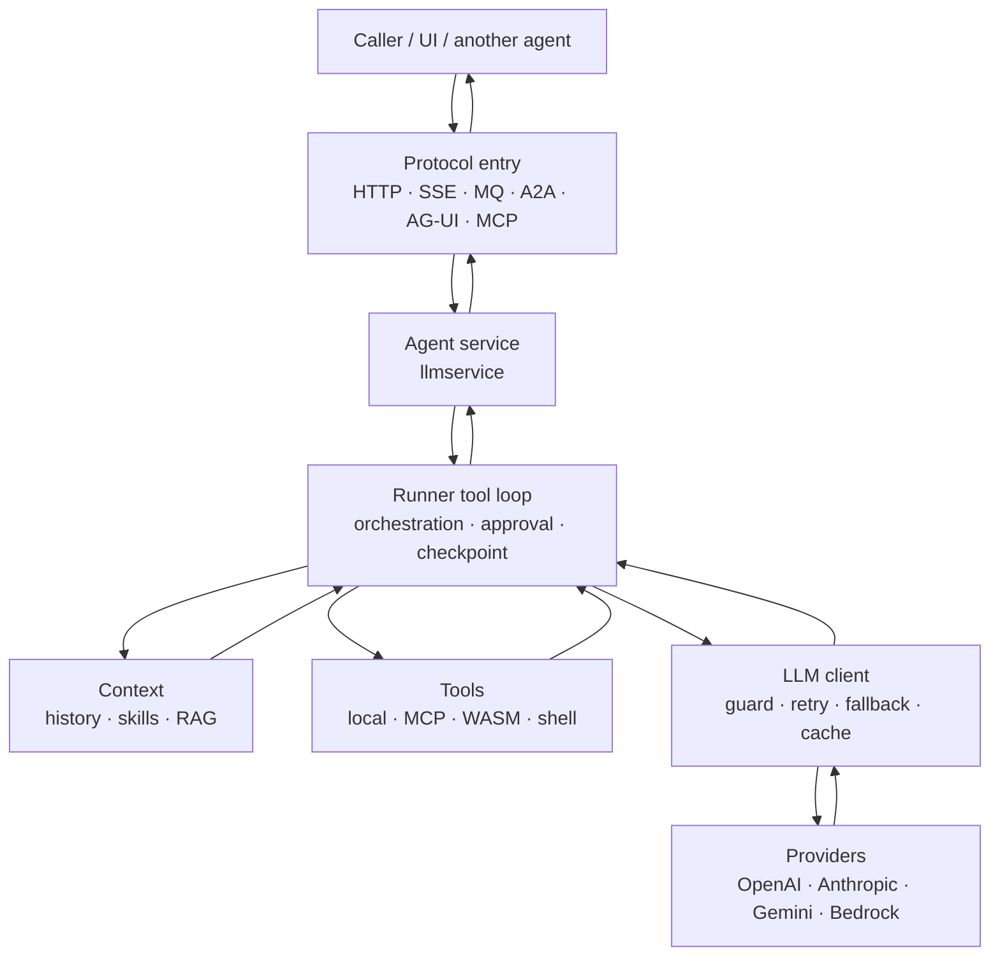

# LLM and Agent

Agent and LLM support lives entirely under `contrib/`. The core module does not import it, and `go build ./...` at the repo root does not compile these modules.
`contrib/llm` is a zero-dependency model client. `llm/agent` is the tool loop and orchestration runtime. Surrounding modules own persistence, process lifecycle, and protocol adapters.

Each layer is its own Go module. `llm` depends on neither the beauty core nor MCP or WASM; glue modules connect them.
Prompt text, model choice, temperature, cost, and which tools or guards to enable stay with the caller. This page maps mechanisms and data flow.
Package-level API: [contrib/llm README](../contrib/llm/README.md).

## Data flow

A request enters the agent from the top. Model and tool results travel back along the same path.



An `agent.Agent` can run inside your own process without `llmservice`. `llmservice` only wraps it as a `beauty.Service` so it shares the HTTP/gRPC start and shutdown order.

## Layers

```text
protocols       a2a · agui · mcp / mcpagent · wasmagent
service         llmservice (workers / SSE / MQ / distributed lock)
memory & obs    llmsession · llmcheckpoint · vector · memoryvector · otelllm
agent runtime   llm/agent (loop, orchestration, skills, session, approval)
model client    llm (Client / Embedder / middleware / providers)
```

| Layer | Modules | Role |
|---|---|---|
| Model client | `contrib/llm` | `Generate` / `Stream`, embeddings, tool calls, provider adapters, call middleware |
| Agent runtime | `contrib/llm/agent` | Model⇄tool loop, approval pause, context, multi-agent orchestration |
| Memory and observability | `llmsession` · `llmcheckpoint` · `vector` · `memoryvector` · `otelllm` | Session and checkpoint storage, semantic search, GenAI traces |
| Service | `contrib/llmservice` | Worker pool, SSE, MQ consume, exclusive continue by `run_id` |
| Protocols | `a2a` · `agui` · `mcp` · `mcpagent` · `wasmagent` | Agent-to-agent, UI event stream, remote tools, wasm sandbox |

## Model client

`Client` is the common interface: `Generate` returns once, `Stream` yields increments as `iter.Seq2`. `Embedder` sits beside it. Image generation, image edit, and speech are implemented on the OpenAI provider.

A request can carry tool calls, JSON Schema structured output, text plus images, extended thinking / reasoning, and Anthropic prompt-cache markers.

| Adapter | Coverage |
|---|---|
| `openai` + `WithBaseURL` | OpenAI, Azure, Zhipu, Kimi, MiniMax, Qwen, DeepSeek, and compatible gateways |
| `instruct` | Local models on `/v1/completions`: ChatML, Llama 3, Mistral, Alpaca, Gemma |
| `anthropic` | Native Messages API |
| `gemini` | Generative Language API; API key or OAuth (Vertex) |
| `bedrock` | SigV4; codec chosen from the model id prefix: Claude / Titan / Llama / Mistral |

Decorators wrap any `Client`. Every model call inside an agent loop passes through them: `Fallback`, `Retry` (a stream that has already yielded is not retried), `Metered`, `Budget`, input/output `Guard`, `Cache`.

`llm/prompt` declares persona, skill catalog, planner instructions, RAG, and guards as slots, then assembles them into `Request` by position and priority before each model call.

To egress through an AI gateway such as Higress, change `WithBaseURL`. See [Higress AI gateway](higress-ai-gateway-en.md).

## Agent runtime

The smallest contract is one `Agent` interface: `Run` / `Continue` return an event stream, `Info` exposes the name and tools. `Runner`, `Chain`, `Team`, `Parallel`, `GroupChat`, `BestOfN`, and `VerifyLoop` all implement it and can nest.

`Runner` loops until a final answer, the step cap (default 8), or an approval pause. Tool calls in the same turn run in parallel by default. An unknown tool or a tool error is fed back as text. Consecutive all-fail rounds trip a breaker (default 3). Events are token, step, tool_start / tool_result, steer, paused, final, and error, each with `AgentName` and a trigger.

Inside the loop:

- **Approval.** Tool permission is Allow / Ask / Deny. Ask pauses the whole turn atomically; the caller resumes with `Continue`. `SyncHITL` blocks in-process for a decision. Standing approvals and `ToolPolicy` also exist (the stricter of policy and the tool's own permission wins; denied tools are not advertised to the model).
- **Hooks.** A turn, a model step, a stream chunk, and the tool boundary can rewrite the request, arguments, and result.
- **Mailbox.** A run can receive a user aside, or a one-shot / persistent system context.
- **History vs context.** `HistoryProvider` loads and stores the session. `ContextProvider` supplies RAG, skills, and `AGENTS.md`. Messages carry a source tag so history is not written twice.
- **Compaction and recovery.** Tool-call JSON can be repaired. Compaction strategies include a sliding window, truncation, tool-result shrinking, and a summarizer that calls a model. `Recovery` handles context overflow and output-token limits.
- **Tool scope.** `ToolScope` filters the visible tools per step. `AgentAsTool` wraps a child agent as one tool of the parent; a child pause bubbles up.
- **Checkpoints.** Pause snapshots go to `RunStore` (in-process by default). `Registry` tracks in-flight calls by request id for cancel and status.

## Orchestration

Use code composition for simple flows. Use `llm/agent/workflow` for branches, loops, and fan-out / fan-in.

| Primitive | Behavior |
|---|---|
| `Chain` | The previous final text is the next input. Any pause pauses the chain. |
| `Team` | A member writes `HANDOFF: <name> <input>` to transfer. A cap and a loop detector apply. |
| `Parallel` | Different agents run the same request concurrently; a Combiner merges them. |
| `BestOfN` | The same agent runs N times; a Selector picks one (longest by default). |
| `VerifyLoop` | After a run, a verifier may reject it and rerun with feedback. |
| `GroupChat` | One speaker per turn; history is broadcast. Default selection is round-robin; selection and termination are replaceable. |
| `workflow` | Agent / LLM / condition / transform nodes, direct edges, conditional edges, fan-out / fan-in, checkpoints. |

`ReActPlanner` is an optional planning seam: it injects planning instructions and keeps the text after `FINAL ANSWER:` as the clean reply.

## Memory, skills, and execution

- **Session.** `session.Manager` wraps any `Agent`, stores multi-turn history, and rolls a summary when the history grows. Memory and JSON files live in the llm module; SQLite / Redis live in `contrib/llmsession`.
- **Long-term memory.** `memory_add` / `memory_search` / `memory_delete`. Default search is substring. `memoryvector` uses an Embedder plus `vector.Store` for semantic search. `vector` ships an in-memory cosine store.
- **Skills.** `SKILL.md` layout. The system prompt lists names only; the model pulls the body, references, and scripts on demand. Script execution is off by default. When enabled it is a local process with path-traversal checks. `wasmagent` can replace the executor with a wasm sandbox, or expose a wasm module as an `agent.Tool`.
- **AGENTS.md.** Files are collected upward from the working directory and concatenated from repository root toward the current directory.
- **Todo.** `harness/todo` injects todo tools through a `ContextProvider`.
- **Shell.** `shelltool` has allow/deny lists and output truncation. Default permission is Ask.

## Protocols and service

| Module | What enters and what leaves |
|---|---|
| `llmservice` | HTTP / MQ tasks enter `Agent.Run`; SSE emits the event stream. Shutdown cancels in-flight runs and flushes checkpoints. Continue takes a lock on `run_id`. |
| `mcp` / `mcpagent` | A service exposes tools over MCP. The client bridges remote tools to `agent.Tool` and feeds text results back to the model. |
| `a2a` | A local `StreamAgent` is an A2A HTTP server. A remote A2A agent is wrapped as `agent.Agent` and can join a Chain or Team. Tokens, tool results, and HITL pauses are mapped. |
| `agui` | POST `RunAgentInput`, respond with SSE (`TEXT_MESSAGE_*` / `TOOL_CALL_*`, and so on). The protocol has no Continue; approval resume is simulated by appending a user message. |

Runnable examples: [agentservice](../examples/agentservice) (guards, tool loop, skills, approval, session, SSE; offline stub by default), [llm-httpui](../examples/llm-httpui).

## Observability

`Metered` in `contrib/llm` hands usage and latency to a callback and does not import the OpenTelemetry SDK. `contrib/otelllm` emits spans and metrics under the GenAI semantic conventions and builds an agent run tree for Jaeger, Tempo, Langfuse, or LangSmith. `OTelMiddleware` in `llm/agent` is also callback-injected, so the SDK stays out of the llm module. Log redaction is `llm/agent/redact`.

## Current boundaries

- The vector store implementation in-tree is in-memory. Implement `vector.Store` for pgvector or Qdrant.
- The resume callback for a paused `AgentAsTool` child lives in process memory, not in `RunStore`. After the parent process restarts, that child's Continue cannot be reattached.
- Evaluation is the `EvaluatorMiddleware` callback. There is no built-in eval set.
- Group-chat speaker selection defaults to round-robin. To let a model pick the next speaker, set `GroupChatManager.SelectNextAgent`.
- Image generation, image edit, and speech exist on the OpenAI provider. Gemini, Anthropic, and Bedrock cover chat, streaming, and tool calls (and some embeddings).
