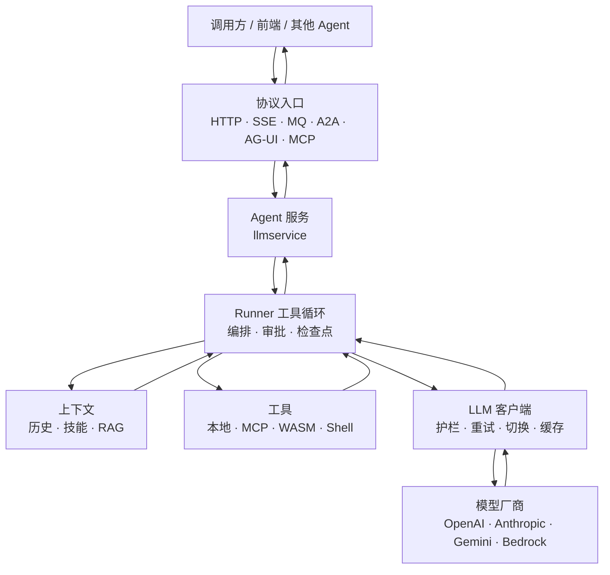

# LLM 与 Agent

Agent 和 LLM 全部在 `contrib/`，核心模块不包含它们，`go build ./...` 也不会编译这些模块。
`contrib/llm` 是零依赖的模型客户端，`llm/agent` 是工具循环和编排运行时，外围模块负责持久化、服务生命周期和协议接入。

各层是独立 Go 模块。`llm` 不依赖 beauty 核心，也不依赖 MCP 或 WASM；胶水模块才把它们接在一起。
prompt、模型、温度、成本、选哪些工具和护栏留给调用方。本篇只画机制和数据流。
包级 API 见 [contrib/llm README](../contrib/llm/README.md)。

## 数据流

请求自上而下进入 Agent，模型与工具的结果再沿原路返回。



可以直接把 `agent.Agent` 嵌进自己的进程，不经过 `llmservice`。`llmservice` 只是把它包成 `beauty.Service`，跟 HTTP / gRPC 共用同一套启停顺序。

## 分层

```text
协议接入    a2a · agui · mcp / mcpagent · wasmagent
服务化      llmservice（worker / SSE / MQ / 分布式锁）
记忆与观测  llmsession · llmcheckpoint · vector · memoryvector · otelllm
Agent 运行时  llm/agent（循环、编排、技能、会话、审批）
模型客户端  llm（Client / Embedder / 中间件 / 多厂商）
```

| 层 | 模块 | 职责 |
|---|---|---|
| 模型客户端 | `contrib/llm` | `Generate` / `Stream`、embedding、工具调用、厂商适配、调用中间件 |
| Agent 运行时 | `contrib/llm/agent` | 模型⇄工具循环、审批暂停、上下文、多 Agent 编排 |
| 记忆与观测 | `llmsession` · `llmcheckpoint` · `vector` · `memoryvector` · `otelllm` | 会话与检查点落盘、语义检索、GenAI trace |
| 服务化 | `contrib/llmservice` | worker 池、SSE、MQ 消费、按 `run_id` 互斥续跑 |
| 协议 | `a2a` · `agui` · `mcp` · `mcpagent` · `wasmagent` | Agent 互调、前端事件流、远程工具、wasm 沙箱 |

## 模型客户端

统一接口是 `Client`：`Generate` 一次返回，`Stream` 用 `iter.Seq2` 推增量。其上还有 `Embedder`。文生图、图编辑、TTS 目前只在 OpenAI provider 上。

请求侧覆盖工具调用、JSON Schema 结构化输出、文本加图片、厂商已托管文件的 `file_id`、extended thinking / reasoning，以及 Anthropic 的 prompt cache 标记。OpenAI 的 prompt cache 读写记进 `Usage`。

| 接法 | 覆盖 |
|---|---|
| `openai` + `WithBaseURL` | OpenAI、Azure、智谱、Kimi、MiniMax、通义、DeepSeek 及兼容网关 |
| `instruct` | 本地模型走 `/v1/completions`：ChatML、Llama 3、Mistral、Alpaca、Gemma |
| `anthropic` | 原生 Messages API |
| `gemini` | Generative Language API；API Key 或 OAuth（Vertex） |
| `bedrock` | SigV4；按模型 id 前缀选 Claude / Titan / Llama / Mistral |

装饰器叠在任意 `Client` 上，agent 循环里的每一次模型调用都会经过它们：`Fallback`、`Retry`（流已经开始产出则不再重试）、`Metered`、`Budget`、输入/输出 `Guard`、`Cache`。

`llm/prompt` 把人设、技能目录、规划指令、RAG、护栏声明成 Slot，按位置和优先级在每次模型调用前组装进 `Request`。

经 Higress 这类 AI 网关出站时，换 `WithBaseURL` 即可，见 [Higress AI 网关](higress-ai-gateway.md)。

## Agent 运行时

最小契约是同一个 `Agent` 接口：`Run` / `Continue` 返回事件流，`Info` 暴露名字和工具。`Runner`、`Chain`、`Team`、`Parallel`、`GroupChat`、`BestOfN`、`VerifyLoop` 都实现它，可以互相嵌套。

`Runner` 做工具循环，直到终态文本、步数上限（默认 8），或审批暂停。同轮多个 tool call 默认并行。未知工具或工具报错把错误文本喂回模型；连续全失败默认 3 轮熔断。事件有 token、step、tool_start / tool_result、steer、paused、final、error，并带 `AgentName` 和触发来源。

循环内的机制：

- **审批**。工具权限是 Allow / Ask / Deny。Ask 时整轮工具原子暂停，调用方 `Continue` 带决议续跑。`SyncHITL` 可在进程内阻塞等人。另有 standing approval 和 `ToolPolicy`（与工具自身权限取更严的一侧，Deny 的工具不会广告给模型）。
- **Hooks**。整轮、单步模型、流式 chunk、工具前后都能改写请求、参数和结果。
- **Mailbox**。运行中可插入用户插话，或一次性 / 持久的 system 上下文。
- **历史与上下文分离**。`HistoryProvider` 负责会话加载和落盘；`ContextProvider` 负责 RAG、Skills、`AGENTS.md`。消息带来源标记，避免历史被重复写入。
- **压缩与恢复**。工具参数 JSON 可修复。上下文压缩有滑动窗口、截断、工具结果压缩，以及需要再调模型的摘要。发给模型前会补上没有结果的工具调用。`Recovery` 处理上下文超长和输出 token 超限。
- **工具范围**。`ToolScope` 按步过滤可见工具。子 agent 可以用 `AgentAsTool` 包成父 agent 的一个工具，子 agent 暂停会冒泡到父级。
- **检查点**。暂停快照进 `RunStore`（默认进程内）。`Registry` 按 request id 跟踪运行中的调用，用于取消和查状态。

## 编排

简单场景用代码组合。条件分支、循环、扇出扇入用 `llm/agent/workflow`。

| 原语 | 行为 |
|---|---|
| `Chain` | 上一步终态文本作为下一步输入；任一步暂停则整链暂停 |
| `Team` | 成员在文本里写 `HANDOFF: <名> <输入>` 移交；有次数上限和打转检测 |
| `Parallel` | 不同 Agent 并发跑同一请求，再用 Combiner 合并 |
| `BestOfN` | 同一 Agent 跑 N 次，用 Selector 选一个（默认取最长） |
| `VerifyLoop` | 跑完后校验，不通过就带反馈重跑 |
| `GroupChat` | 每轮选一个发言者并广播历史；默认轮询，选择和终止可换成自己的函数 |
| `workflow` | Agent / LLM / 条件 / 变换节点，直连、条件边、扇出扇入，带检查点 |

`ReActPlanner` 是可选的规划接缝：注入规划指令，并把 `FINAL ANSWER:` 之后的文本收成干净答复。

## 记忆、技能与执行

- **会话**。`session.Manager` 包在任意 `Agent` 外，持久化多轮历史，超长时滚动摘要。摘要可按输入 token 预算只折完整前缀，内容块里的文字也会计入。每次 run 单独成行，可按游标分页；token 合计写在 run 和会话上。内存和 JSON 文件在 llm 模块内；SQLite / Redis 在 `contrib/llmsession`。
- **长期记忆**。`memory_add` / `memory_search` / `memory_delete`。默认子串检索；`memoryvector` 用 Embedder + `vector.Store` 做语义检索。`vector` 自带内存余弦检索。
- **Skills**。按 `SKILL.md` 规范，系统提示只放名录，模型按需拉全文、读引用、跑脚本。脚本默认关闭；打开后是本地进程，路径有穿越防护。`wasmagent` 可以把执行器换成 wasm 沙箱，或把 wasm 模块直接当成 `agent.Tool`。
- **AGENTS.md**。从工作目录向上收集，按「仓库根 → 当前目录」拼进系统提示。
- **Todo**。`harness/todo` 提供待办工具，作为 `ContextProvider` 注入。
- **Shell**。`shelltool` 带允许/拒绝列表和输出截断；默认权限是 Ask。

## 协议与服务化

| 模块 | 数据从哪进、到哪出 |
|---|---|
| `llmservice` | HTTP / MQ 任务 → `Agent.Run`；SSE 把事件流推出。停机时取消进行中的 Run 并刷检查点。审批续跑按 `run_id` 加锁。 |
| `mcp` / `mcpagent` | 本服务把能力暴露成 MCP 工具；客户端把远程工具桥成 `agent.Tool`，结果文本喂回模型。 |
| `a2a` | 本地 `StreamAgent` 暴露成 A2A HTTP；远程 A2A agent 包装回 `agent.Agent`，继续参与 Chain / Team。token、工具结果、HITL 暂停有协议映射。 |
| `agui` | POST `RunAgentInput`，响应为 SSE（`TEXT_MESSAGE_*` / `TOOL_CALL_*` 等）。同一 thread 的 `state` 第一次发快照，之后只发 JSON Patch 差量。协议没有 Continue，审批续跑用追加用户消息模拟。 |

可运行示例：[agentservice](../examples/agentservice)（护栏、工具循环、技能、审批、会话、SSE，默认可离线 stub）、[llm-httpui](../examples/llm-httpui)。

## 可观测

`contrib/llm` 的 `Metered` 只把用量和延迟交给回调，不绑 OpenTelemetry SDK。`contrib/otelllm` 按 GenAI 语义约定打 span 和指标，并给 agent 循环建 run tree，可接到 Jaeger、Tempo、Langfuse、LangSmith。`llm/agent` 里的 `OTelMiddleware` 同样通过回调注入，避免把 SDK 依赖带进 llm 模块。日志脱敏在 `llm/agent/redact`。

## 当前边界

- 向量库只有内存实现。接 pgvector / Qdrant 时实现 `vector.Store`。
- `AgentAsTool` 暂停后续跑的回调在进程内存里，不进 `RunStore`。父进程重启后，子 run 的 Continue 接不回去。
- 评估是 `EvaluatorMiddleware` 的一个回调，没有内置评测集。
- 群聊发言人默认轮询。要让模型选下一个发言者，实现 `GroupChatManager.SelectNextAgent`。
- 图片生成、编辑、语音只在 OpenAI provider 上。Gemini / Anthropic / Bedrock 覆盖对话、流式和工具调用（及部分 embedding）。
