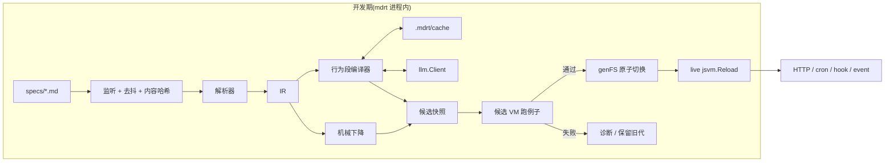
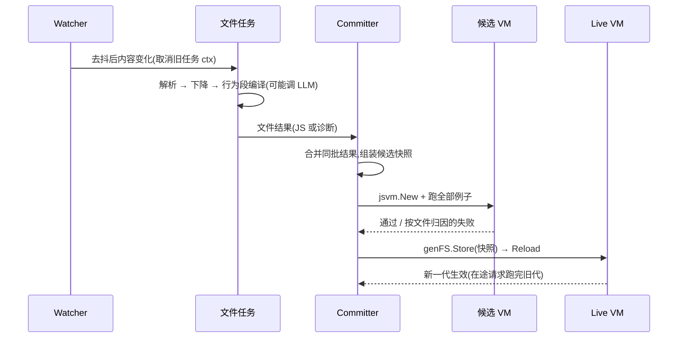

# Markdown 即代码运行时(实验计划)

> 状态:实验实现在 [`contrib/mdrt`](../contrib/mdrt)。独立模块,依赖 `contrib/jsvm`、`contrib/llm` 和 beauty 核心。
> 核心模块不引入任何 LLM 依赖。生产进程可以只嵌入 `mdrt.Build` 的产物,用 `jsvm.WithFS` 运行。

开发者维护 `specs/*.md`,运行时监听文件变化,把 Markdown 编译成 jsvm 脚本并热切换。能用确定性规则翻译的
段落(路由、入参、鉴权、定时、例子)由解析器直接生成;只有自然语言写的「行为」段落交给 LLM 生成函数体。
生成结果必须通过该文件里写的例子才会上线;请求路径上永远不调用模型。

## 1. 目标与非目标

**目标**

- 保存 Markdown 后,纯机械改动(改路由、改校验、改例子)在 500ms 内生效;
- 行为段落改动经 LLM 编译 + 例子验收后生效,失败时旧版本继续服务;
- 生产环境不依赖 LLM:`build` 产出冻结的 JS,直接用 `jsvm.WithFS(embed.FS)` 运行;
- 同一段文字只编译一次,结果写入锁文件随 git 提交,可复现、可审查。

**非目标(本实验不做)**

- 自由散文直接变程序:方言之外的标题报错,不猜;
- gRPC、数据库直连、多文件 `require`:状态只走 `$app.store()`,外部能力只走受限 HTTP;
- 按单文件强隔离:所有 spec 共享一个 jsvm,隔离靠静态检查 + 宿主配置,不是沙箱级隔离;
- wasm 执行面。

## 2. 总体架构



| 组件 | 职责 | 关键约束 |
|---|---|---|
| Watcher | fsnotify 监听 `specs/`,按文件去抖,内容哈希去重 | 新的保存取消该文件进行中的编译 |
| Parser | 行级解析受限方言 → IR,所有错误带行号 | 不调模型;未知标题即报错 |
| Lowerer | IR 中确定性部分 → JS 片段 | 输出稳定:同一 IR 字节级相同 |
| BehaviorCompiler | 「行为」段 → 函数体;缓存、单飞、修复重试 | 输出必须通过 AST 静态检查 |
| Verifier | 用隔离的候选 VM 跑全部例子 | 不碰线上 store、不发真实 HTTP |
| Committer | 单协程:组装快照 → 验收 → 切换 genFS → `live.Reload` | 唯一写者,串行化所有换代 |
| Live VM | 普通 `jsvm.VM`,源是 genFS | `WithWatch(false)`,由 mdrt 驱动重载 |

### 2.1 为什么用 genFS 而不是写临时目录

`jsvm.Reload` 每次都通过 `fs.Glob` + `fs.ReadFile` 重新读取 `WithFS` 给的文件系统。mdrt 给 live VM 一个
自定义 `fs.FS`,内部是 `atomic.Pointer[snapshot]`:

```go
type genFS struct{ cur atomic.Pointer[snapshot] }   // snapshot: map[文件名][]byte,不可变

func (g *genFS) Open(name string) (fs.File, error) { return g.cur.Load().Open(name) }
```

只有 Committer 会 `Store`,而且它在 `Store` 之后才调 `Reload`、等 `Reload` 返回后才处理下一批,所以一次
`Reload` 期间读到的一定是同一个快照,不存在「写了一半的目录」。

## 3. Markdown 方言 v0

### 3.1 文件约定

- 一个文件一个模块:`specs/<slug>.md`,slug 匹配 `^[a-z0-9]+(-[a-z0-9]+)*$`;
- 生成物 `<slug>.js`,前置手写的 `000_mdrt_prelude.js`(随 mdrt 版本发布,不由模型生成);
- 文件以 frontmatter 开头,复用 `contrib/llm/agent/skills` 的最小 YAML 子集解析思路。

```yaml
---
dialect: mdrt/v0          # 必填,方言版本
name: orders              # 必填,与文件名 slug 一致
auth: bearer              # 本文件默认鉴权:none | bearer
http: [api.example.com]   # 本文件允许访问的外部域名,默认空(禁止出网)
---
```

### 3.2 单元(一级标题)

| 一级标题 | 含义 | 下降结果 |
|---|---|---|
| `# GET /orders/{id}` | HTTP 路由,方法 + Go 1.22 ServeMux 模式 | `routerAdd(...)` |
| `# cron cleanup 0 */5 * * * *` | 定时任务,秒级 spec | `cronAdd(...)` |
| `# hook order.create` | Go 侧 `vm.Trigger` 的扩展点 | `hookAdd(...)` |
| `# event user.signup` | 订阅事件总线 | `eventSubscribe(...)` |

其他一级标题报错。每个单元另外登记一个内部钩子 `mdrt:unit:<slug>:<序号>`,供验收时直接调用(cron 和
event 单元没有别的触发方式)。

### 3.3 小节(二级标题)

中英文标题等价,大小写不敏感。

| 小节 | 别名 | 适用单元 | 内容 | 谁处理 |
|---|---|---|---|---|
| `## 鉴权` | Auth | 路由 | `none` / `bearer`,覆盖 frontmatter | 解析器 |
| `## 输入` | Input | 路由 / hook / event | 字段列表(见 3.4) | 解析器 |
| `## 行为` | Behavior | 全部 | 自然语言 | LLM |
| `## 实现` | Impl | 全部 | 一个 ```` ```js ```` 代码块,函数体 | 原样使用,不调 LLM |
| `## 例子` | Examples | 全部 | 若干三级标题,每个一组 req/res(见 3.5) | 解析器 + 验收 |

规则:

- `行为` 与 `实现` 二选一,都没有则报错;`实现` 是逃生口,也是阶段 0 的唯一实现方式;
- 有 `行为` 的单元至少要两个例子,其中一个要覆盖边界或错误分支,否则报错(防止生成代码只对单一样本成立);
- 未识别的二级标题报错;三级及以下标题只在 `例子` 里有意义。

### 3.4 输入语法

```markdown
## 输入
- id (path): string
- amount: number, > 0
- note: string, 可选, 长度 0..200
- level: string, 枚举 gold|silver
```

- 每行 `- <名字> [(位置)]: <类型>[, <约束>...]`;
- 位置:`path`、`query`、`body`、`header`。默认:路径模式里出现的 `{x}` 是 path;GET/DELETE 其余字段是
  query;其他方法是 body(JSON);
- 类型:`string` `number` `integer` `boolean` `object` `array`;
- 约束:`可选`/`optional`、`> n`、`>= n`、`< n`、`<= n`、`长度 a..b`/`len a..b`、`枚举 a|b`/`enum a|b`、
  `正则 /.../`/`pattern /.../`;
- 无法识别的约束是解析错误,不是「交给模型理解」。

输入编译成 JSON 描述,由 prelude 里的 `__mdrt.input(e, schema)` 统一校验,失败抛 `BadRequestError`,
`data` 里带字段名。

### 3.5 例子语法

````markdown
## 例子

### 满 1000 打九折
```store
{"orders:seq": 7}
```
```req
POST /orders
Authorization: Bearer $token(u1)

{"amount": 1200}
```
```res
201
{"amount": 1200, "pay": 1080, "id": "$any"}
```
```store-after
{"orders:seq": 8}
```

### 金额非法
```req
POST /orders
Authorization: Bearer $token(u1)

{"amount": 0}
```
```res
400
```
````

- `store`:例子执行前写入候选 VM 的 store(可选);`store-after`:执行后断言(子集匹配,可选)。
  这两个块里写的是完整键,即带 `<slug>:` 前缀(业务代码里的 `ctx.store.get("seq")` 对应 `orders:seq`);
- `req`:首行 `METHOD path?query`,随后请求头,空行后是请求体;`$token(uid)` 由验收器用测试密钥签发;
- `res`:首行状态码;有体时做 JSON 子集匹配:对象只比较期望里出现的键,数组按位置比较且长度必须相等,
  `"$any"` 匹配任意值,数字按 1e-9 容差比较;非 JSON 体按全文比较;
- hook 单元用 ```` ```event ```` / ```` ```event-after ```` 代替 req/res;cron 单元只有 store/store-after;
  event 单元用 ```` ```event ```` 给 payload;
- 每个例子在全新候选 store 上执行,例子之间互不影响。

## 4. IR

```go
type Spec struct {
	Slug     string
	Path     string
	Dialect  string
	Auth     AuthKind
	HTTPAllow []string
	Units    []Unit
}

type Unit struct {
	Kind     UnitKind // Route / Cron / Hook / Event
	Line     int
	Method, Pattern  string // Route
	Name, CronSpec   string // Cron / Hook / Event
	Auth     *AuthKind
	Inputs   []Field
	Behavior *Text   // 自然语言,含起止行号
	Impl     *Text   // 手写函数体
	Examples []Example
}

type Field struct {
	Name, Type string
	In         Location
	Optional   bool
	Min, Max   *float64 // 含开闭区间标记
	Enum       []string
	Pattern    string
	Line       int
}
```

解析器是行级状态机(标题、列表项、围栏代码块三种 token),不引 Markdown 库:方言足够小,而且行号必须准确,
诊断要直接指回编辑器里的行。

## 5. 机械下降

### 5.1 统一函数签名

每个单元的业务逻辑都是一个函数,机械部分负责把它接到 jsvm:

| 单元 | 业务函数签名 | 返回 / 副作用 |
|---|---|---|
| 路由 | `(input, ctx)` | `{status, body, headers?}`;出错用 `ctx.fail(status, msg, data)` |
| hook | `(event, input, ctx)` | 修改 `event`;拒绝用 `ctx.fail` |
| event | `(payload, input, ctx)` | 无 |
| cron | `(ctx)` | 无 |

`ctx` 由 prelude 构造,是生成代码触达宿主能力的**唯一入口**:

| 成员 | 说明 |
|---|---|
| `ctx.uid` | bearer 鉴权解析出的 `sub`,未鉴权为 `""` |
| `ctx.store.get/set/has/remove` | 包装 `$app.store()`,键自动加 `<slug>:` 前缀 |
| `ctx.http.send(req)` | 包装 `$http.send`,先按本文件 `http:` 列表检查域名 |
| `ctx.log.info/warn/error` | 包装 `$app.logger()`,自动带 `spec`、`unit` 字段 |
| `ctx.now()` | 毫秒时间戳;验收时可固定 |
| `ctx.id()` | 随机 ID(`$security.randomString`) |
| `ctx.fail(status, msg, data)` | 抛 `ApiError` |
| `ctx.trigger(name, event)` | 同步调用 `hookAdd` 注册的钩子,并允许修改 `event`。静态检查禁止直接写 `$app`,跨文件钩子走这里 |

### 5.2 生成样例

`specs/orders.md` 的 `POST /orders` 下降后:

```js
// 由 mdrt 生成,勿手改。source=specs/orders.md#L8 sha256=ab12… behavior=cache:3f9c…
const __orders_u0_fn = function (input, ctx) {
  // ↓ 行为段编译产物
  const pay = input.amount > 1000 ? Math.round(input.amount * 0.9) : input.amount;
  const seq = (ctx.store.get("seq") || 0) + 1;
  ctx.store.set("seq", seq);
  return { status: 201, body: { id: "o" + seq, amount: input.amount, pay: pay } };
};
const __orders_u0_schema = {"amount":{"in":"body","type":"number","gt":0}};

routerAdd("POST", "/orders", (e) => {
  const ctx = __mdrt.ctx(e, "orders", 0, __mdrt.bearer(e));
  const input = __mdrt.input(e, __orders_u0_schema);
  __mdrt.respond(e, __orders_u0_fn(input, ctx));
});
hookAdd("mdrt:unit:orders:0", (ev) => __mdrt.invoke(ev, __orders_u0_fn, __orders_u0_schema, "orders", 0));
```

要点:

- 入口脚本在 jsvm 里共享全局作用域,所以所有顶层名字加 `__<slug>_u<序号>_` 前缀;
- 注册调用都在顶层,顺序由 IR 决定,保证各实例注册序列一致(jsvm 的硬约束);
- 业务函数是普通函数,没有 `async`、Promise(jsvm 不支持事件循环);
- bearer 的密钥不经过 JS 源码,由 Go 侧 `jsvm.WithGlobal("__mdrtConf", ...)` 注入。

## 6. 行为段编译

### 6.1 请求构造

```go
req := llm.Request{
	Model:       cfg.model,
	System:      systemPrompt,          // 固定:签名约定 + ctx 小抄 + 禁止项 + 输出格式
	Messages:    []llm.Message{userMsg}, // 行为文本 + 输入 schema + 例子(作为测试用例)
	Temperature: 0,
	ResponseFormat: typed.Format(),      // llm.NewTypedOutput[struct{ Body, Notes string }]
	SystemCacheControl: "ephemeral",     // 系统提示固定,吃 prompt cache
}
```

- 模型只写**函数体**,签名和外层包装由下降器生成;
- 例子以「输入 → 期望输出」的形式给模型,并明确说明会被用来验收;
- 用户消息里不放其他文件内容,上下文只有本单元。

### 6.2 静态检查

函数体包成 `(function (input, ctx) { … })` 后用 `goja/parser` 解析出 AST 并遍历,不用正则:

- 能解析;
- 禁止的标识符:`routerAdd` `routerUse` `cronAdd` `cronRemove` `hookAdd` `eventSubscribe` `onStart`
  `onStop` `onReload` `require` `eval` `Function` `Promise` `globalThis` `sleep`,以及 `$app` `$http`
  `$os` `$filesystem` `$security`(只能通过 `ctx` 使用);
- 禁止 `async` 函数、`await`、生成器、`with`;
- 代码长度上限(默认 8KB),防止模型把整段逻辑展开成查表。

检查失败视为一次编译失败,进入修复重试。

### 6.3 修复重试

最多两轮。每轮把上一轮的函数体和失败原因(AST 违规、加载报错,或者失败例子的期望/实际差异)追加到对话里
重新生成。两轮后仍失败,该单元标记为 failed,本文件保留上一版通过的 JS。

### 6.4 缓存与锁文件

```
cacheKey = sha256(dialect, preludeVersion, promptVersion, model, unitKind,
                  normalize(behaviorText), canonicalJSON(inputs))
```

- **例子不进 key**。只改例子时,先拿缓存的函数体重新验收,通过就不调模型;不通过才带着失败差异去修复;
- `normalize` 只折叠空白和行尾,不改语义;
- 缓存:`.mdrt/cache/<key>.json`(函数体、模型、用量、时间);
- 锁文件:`mdrt.lock.json`,记录每个单元当前采用的 key 与函数体哈希,**提交到 git**。代码评审看的是锁文件
  和生成 JS 的 diff,而不是只看 Markdown;
- 同一 key 的并发请求单飞(`pkg/foundation/syncx` 的 singleflight);全局 LLM 并发上限默认 4。

## 7. 验收

### 7.1 候选 VM

每次换代前用整份候选快照新建一个 VM,只跑例子、不调用 `Start`:

```go
cand, err := jsvm.New(
	jsvm.WithFS(snap, "*.js"),
	jsvm.WithPoolSize(2),                       // ≥2 才能发现注册序列不一致
	jsvm.WithEventBus(eventbus.New[any]()),     // 独立总线;不配总线时 eventSubscribe 会直接报错
	jsvm.WithBucket(blob.NewMemory()),
	jsvm.WithHTTPClient(fixtureClient),         // 不出网;返回例子里声明的桩或 599
	jsvm.WithTimeout(2*time.Second),
	jsvm.WithGlobal("__mdrtConf", testConf),    // 测试 JWT 密钥、固定时钟
)
```

候选 VM 有自己的 store,不调用 `Start` 就不会跑 cron、不会触发 `onStart`,天然与线上隔离。

### 7.2 执行

- 路由例子:`httptest` 构造请求,直接调 `cand.ServeHTTP`;
- hook / event / cron 例子:`cand.Trigger(ctx, "mdrt:unit:<slug>:<n>", ev)`;
- 每个例子前清空 store,再写入 `store` 块。`$app.store()` 只有 `get/set/has/remove`,没有清空和列举,
  所以 `ctx.store.set` 会把写过的键登记到索引键 `__mdrt:keys`,内部钩子 `mdrt:reset` 按索引逐个删除。
  静态检查禁止绕过 `ctx.store`,这份索引在候选 VM 里是完整的;
- **跑快照里所有文件的全部例子**,不只跑改动的文件:跨文件的路由冲突、钩子联动只有整体验收才能发现。
  例子都在内存里执行,几十个例子是毫秒级。

### 7.3 结果

- 全部通过:Committer 切换 genFS 并 `live.Reload`;
- 任一失败:本批改动中**导致失败的文件**回退到它的上一版通过的 JS,其余文件的改动照常上线;回退后再验收一次;
- `jsvm.New` 本身失败(语法错、路由冲突、cron spec 非法):同样按文件归因。归因不出来时整批回退。

## 8. 换代与并发



- **按文件去抖**:默认 300ms;去抖后内容哈希与上次处理的相同则丢弃(编辑器保存经常产生多次事件);
- **按文件取消**:每个文件同时只有一个编译任务,新变化取消旧任务的 ctx,正在进行的 LLM 请求随之取消;
- **Committer 单协程**:它是 genFS 唯一的写者。等待期间到达的多个文件结果合并成一批,一次验收、一次 `Reload`;
- **每个文件各自保留上一版通过的 JS**:一个文件写坏不会拖住其他文件上线;
- **删除 / 重命名**:删除文件即从快照移除对应 JS,同样经过验收(可能有其他文件依赖它的钩子);
- **启动**:从锁文件 + 缓存直接组装第一代,不调模型。缓存缺失的行为单元生成占位实现
  `ctx.fail(503, "mdrt: behavior not compiled")`,然后在后台编译;
- **live store 跨代保留**是 jsvm 已有语义;mdrt 不清线上 store,结构变更由 spec 作者自己处理。

## 9. 运行模式

| 模式 | 监听 | 调 LLM | 缺缓存时 | 用途 |
|---|---|---|---|---|
| `ModeDev` | 是 | 是 | 后台编译,先上 503 占位 | 本地开发。可运行示例是 `contrib/mdrt/example/llm` |
| `ModeOffline` | 是 | 否 | 503 占位 + 诊断 | 无模型的本地运行、CI 冒烟。示例是 `contrib/mdrt/example` |
| `ModeBuild` | 否 | 可选 | 报错退出 | 产出 `gen/*.js` + 锁文件。冻结运行见 `example/frozen` |

生产推荐 `Build` 产物 + `embed.FS` + 原生 `jsvm.WithFS`,运行时连 mdrt 都不需要。CI 跑
`Build --offline`:锁文件和缓存齐全才能通过,保证没有人把未评审的生成代码带进主干。

## 10. 安全与能力边界

| 层 | 机制 | 强度 |
|---|---|---|
| 宿主配置 | live VM 固定 `WithOS(false)`、`WithTimeout`、`WithMaxBodySize` | 强 |
| 出网 | `WithHTTPClient` 的 Transport 只放行所有 spec `http:` 列表的并集 | 强(进程级) |
| 单文件出网 | `ctx.http` 按本文件 `http:` 列表再检查 | 中:依赖静态检查禁止直接用 `$http` |
| store 命名空间 | `ctx.store` 自动加 `<slug>:` 前缀 | 中:依赖静态检查禁止直接用 `$app` |
| 代码审查 | 锁文件 + 生成 JS 进 git,CI 要求离线可构建 | 流程 |

单文件级别的边界本质上是**约定 + 静态检查**,不是沙箱。要做真正的按文件隔离,需要每个 spec 一个 jsvm,
或者走 wasm,这些不在本实验范围内。

Markdown 的作者被视为可信开发者;外部贡献的 spec 改动按代码对待,评审锁文件 diff。

## 11. Go API 草案

```go
client := openai.New(os.Getenv("LLM_API_KEY")) // 兼容网关再加 openai.WithBaseURL
rt, err := mdrt.New(
	mdrt.WithSpecDir("specs"),
	mdrt.WithStateDir(".mdrt"),                    // cache/、gen/、诊断
	mdrt.WithLockFile("mdrt.lock.json"),
	mdrt.WithMode(mdrt.ModeDev),
	mdrt.WithLLM(client, os.Getenv("LLM_MODEL")),  // 不配则行为段只走缓存或 503
	mdrt.WithJWTSecret(os.Getenv("JWT_SECRET")),
	mdrt.WithJSVM(jsvm.WithBucket(bucket), jsvm.WithEventBus(bus)), // 透传给 live VM
	mdrt.WithLogger(slog.Default()),
)
if err != nil { log.Fatal(err) }

app := beauty.New(
	beauty.WithService(rt),          // Start:启动 live VM + 监听 + 后台编译
	beauty.WithWebServer(":8080", rt), // ServeHTTP 转给 live VM
)
_ = app.Start(ctx)

st := rt.Status() // 每个文件:当前代、状态(ok/pending/failed)、诊断(行号 + 信息)
```

可运行的接法在 [`contrib/mdrt/example/llm`](../contrib/mdrt/example/llm):读 `LLM_API_KEY`(或 `OPENAI_API_KEY`)、`LLM_MODEL`,可选 `LLM_BASE_URL`。spec 是 `POST /quote`,九折写在「行为」里。编译完成前该路由返回 503。客户端发出的是 OpenAI `json_schema`;网关不支持时看 `.mdrt/diagnostics.json`,不会用失败的函数体换代。

`mdrt.Build(ctx, opts...)` 供 CLI / CI 调用。后续可以在 `tools/` 加 `beauty md dev|build`,本实验先不动 CLI。

## 12. 可观测

- 日志:每次换代一条,带 `gen`、改动文件、耗时分解(解析 / 下降 / 编译 / 验收 / Reload)、失败归因;
- 指标:保存到生效的延迟(按「机械 / 行为」分桶)、缓存命中率、LLM 调用次数与 token(复用 `llm.Usage`,
  可接 `contrib/otelllm`)、例子通过率、修复轮次分布、回退次数;
- 诊断:`.mdrt/diagnostics.json`,格式对齐 LSP 的 `file / line / severity / message`,方便后续接编辑器。

## 13. 里程碑

### M0 方言与解析器

- 交付:IR、行级解析器、frontmatter、输入与例子语法;golden 测试覆盖每条语法规则和每类错误;
- 验收:错误信息全部带准确行号;未识别语法 100% 报错而不是忽略;
- 停损:如果夹具服务(见 14)用这套方言写不出来,说明方言粒度不对,先改方言,不进 M1。

### M1 机械下降 + 换代(不接 LLM)

- 交付:prelude、下降器、genFS、候选 VM 验收、Committer、Watcher、`## 实现` 逃生口、`Offline` 模式;
- 验收:
  - 夹具服务全部用 `实现` 跑通,所有例子通过;
  - 机械改动保存到生效 p95 < 500ms;
  - 写坏一个文件,其他文件的改动仍能上线,写坏的文件保持旧版;
  - 压测期间连续换代:无请求失败、store 不丢、`go test -race` 通过;
- 停损:如果 `Reload` 在压测下出现请求失败或 store 丢失,先修 jsvm,不往上叠功能。

**M1 通过,「Markdown 作为可热更新的规格」就已经成立,即使后面的 LLM 部分失败。**

### M2 行为段编译

- 交付:BehaviorCompiler、AST 静态检查、修复重试、缓存、锁文件、`Dev` 模式;
- 评测集:20 个行为段(见 14),每个独立生成 5 次;
- 验收:
  - 首次生成即通过例子 ≥ 80%,两轮修复内 ≥ 95%;
  - 单次编译 p50 < 10s;
  - 只改例子或非行为段时零次 LLM 调用;
  - 静态检查拦截率:评测集中故意诱导越权(要求读环境变量、直接调 `$http`)的样例 100% 被拦;
- 停损:两轮修复内通过率 < 80% 或 p50 > 30s,则 LLM 路径降级为 `Build` 时的离线生成工具,运行时只保留
  机械下降 + 缓存。

### M3 冻结构建与能力边界

- 交付:`Build` 模式、`embed` 产物示例、CI 离线校验、出网白名单 Transport、`Status()`、诊断文件;
- 验收:生产示例不链接 `contrib/llm`;CI 在缓存缺失时失败;未声明的域名请求被拒并记日志。

### M4 体验(可选)

- `beauty md dev|build` 子命令;编辑器读取诊断文件;生成代码 diff 预览;需要人工确认才上线的 `Review` 模式。

## 14. 评测夹具

**夹具服务 [`contrib/mdrt/example/specs`](../contrib/mdrt/example/specs)**:三个 spec 文件,覆盖全部单元类型,全部走 `## 实现`,不调用模型。接模型的行为段示例是 [`example/llm/specs/quote.md`](../contrib/mdrt/example/llm/specs/quote.md)。

| 文件 | 单元 | 覆盖点 |
|---|---|---|
| `orders.md` | `POST /orders`、`GET /orders/{id}` | bearer、body/path 输入、store 读写、错误分支 |
| `pricing.md` | `hook order.create` | 修改 event、拒绝、被 `orders` 通过 `$app.trigger` 调用(跨文件) |
| `jobs.md` | `cron cleanup`、`event user.signup` | store 前后断言、事件 payload |

**行为评测集**(20 条,每条带 2~4 个例子):折扣与阶梯计价、分页切片、幂等去重(store 记录已处理 ID)、
计数限流(store 计数 + 时间窗口)、状态机迁移(非法迁移返回 409)、字段脱敏、排序 + 截断、日期区间判断、
多条件校验并汇总错误、按外部 HTTP 结果分支(桩)等。其中 3 条故意诱导越权,用于验证静态检查。

每次评测记录:模型、通过率、修复轮次、延迟、token、生成代码长度,写入 `.mdrt/eval/<时间>.json`,
换模型或改 prompt 时对比。

## 15. 风险与未决问题

| 风险 | 应对 |
|---|---|
| 同一段文字每次生成的代码不同 | 锁文件冻结;只有行为文本或签名变化才重新生成 |
| 生成代码只对例子成立 | 至少两个例子且含边界;提示里声明例子是测试;评审时看生成 JS diff |
| 文意与代码悄悄漂移 | 生成代码进 git;`Review` 模式要求人工确认 |
| 共享全局作用域导致跨文件冲突 | 名字前缀 + 静态检查禁止访问 `globalThis` |
| 静态检查被绕过(字符串拼接访问全局等) | 宿主层的出网、OS、超时限制兜底;单文件边界只承诺「约定级」 |
| jsvm 每个实例都执行一遍全部脚本 | 顶层只做注册;spec 数量多时控制 `WithPoolSize` |
| 成本 | 缓存 + 例子不进 key + prompt cache;评测时统计每次保存的平均 token |

实验里已经定下的选择:

1. 外部 HTTP 桩用例子里的 ```` ```stub ```` 块,第一行是 `METHOD url`,第二行是状态码,剩下的是正文。验收时只在当前例子生效。
2. 不做 spec 之间的 `uses` 依赖。每次换代都跑当前快照里的全部例子。
3. 单元自包含。跨文件只通过 `ctx.trigger` 调钩子,不共享函数。
4. 英文二级标题 `Auth` / `Input` / `Behavior` / `Impl` / `Examples` 和中文标题等价。
